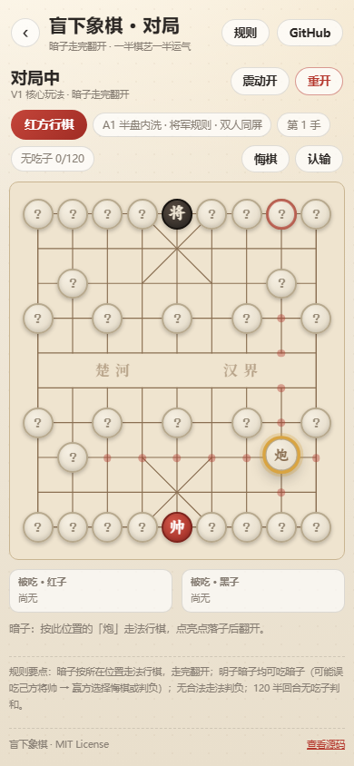

# 盲下象棋 · 打开即玩

> 标准象棋盘 · 开局暗置洗牌 · 走完翻开 · 一半棋艺一半运气

**在线对弈：[https://ink-rui.github.io/blind-xiangqi-mp/](https://ink-rui.github.io/blind-xiangqi-mp/)**

浏览器直接打开就能玩，无需安装、无需登录。手机与桌面都适配，支持双人同屏、五档 AI 陪练和异地联机对战。



设置页在桌面端是双栏卡片布局，手机端自动收成单列；对局页为手机优先版式，顶部是走子方与手数胶囊，棋盘下方是双方被吃棋子托盘。手机上可用浏览器菜单“添加到主屏幕”，以独立窗口打开。

## 玩法

- 棋盘、走子规则与标准中国象棋一致
- 开局按所选模式洗牌，棋子背面朝上；走到哪一格才翻开哪一格
- 暗子按它所在位置的「位置型棋种」走法移动，翻开后按真实身份行棋
- 轮到你时，可操作己方半盘的暗子与己方颜色的明子
- 暗子谁都可以吃；误吃己方将帅按吃将判负，双人同屏可协商悔一步
- 三种洗牌模式（A1 半盘内洗 / A2 跨河全混 / B 全盘混洗）、两种胜负规则（将军 / 吃将即胜）
- 悔棋、认输、重开；120 半回合无吃子或三次重复局面判和
- 今日一局：每天一副固定牌面，和 AI 交手，同一天所有人开局相同；不提供悔棋，结束后自动计入今日排行榜
- 今日排行榜：设置页与终局面板展示当天前 10 名，按胜/和/负、手数、用时排序；昵称保存在本地，同一设备当天只保留更好的一次
- 五档 AI：入门（随机）、普通（偏好吃子）、困难（风险评估）、高手（预判应手）、大师（更宽预判、几乎不失误）
- 本地战绩：AI 与联机对局自动记录胜负、胜率、连胜与最近 5 局，存在浏览器本地
- 计时与回放：对局顶部显示整局用时；结束后可逐步回放本局，支持自动播放
- 棋谱：对局中随时查看/复制着法记录，结束后可保存战绩图（含用时与累计战绩）
- 音效与震动可分别开关，偏好记在本地
- 联机：一方建房把链接发给对手，双方实时同步；顶部显示对手在线状态，断网会自动重连；联机不提供悔棋，误吃己方将帅直接判负
- 离线可用：首次打开后静态资源会缓存，断网仍能开新局；联机对局在断线时提示重连中

## 目录结构

```
docs/                 # 网页版（GitHub Pages 静态托管，无构建依赖）
  index.html
  manifest.webmanifest  # 添加到主屏幕（PWA）
  assets/style.css
  assets/app.js       # 交互与对局流程
  assets/engine.js    # 由 miniprogram/core/engine.ts 编译而来
  assets/rules.js     # 终局判定（重复局面 / 无吃子 / 吃将），可单测
  assets/stats.js     # 本地战绩统计（纯函数，可单测）
  assets/leaderboard.js  # 今日榜昵称、身份与排序口径（纯函数，可单测）
  assets/net.js       # 联机网络层（纯 fetch 调 Supabase PostgREST）
  assets/config.js    # Supabase 地址与 anon key（留空则联机不可用）
  robots.txt          # 搜索引擎抓取规则
  sitemap.xml         # 站点地图
  sw.js               # Service Worker：静态资源缓存与离线回落
  assets/icon-*.png   # 站点图标
  assets/og.png       # 分享预览图
supabase/schema.sql   # 联机房间表 + RLS 策略
miniprogram/          # 微信小程序（原生 + TypeScript）
  core/engine.ts      # 棋规引擎：洗牌、走子合法性、终局判定（两端共用）
  core/net.ts         # 云开发联机封装
  pages/              # 首页与对局页
cloudfunctions/room/  # 联机云函数（create/join/sync/move/ask/answer/resign/close）
dev-notes/            # 开发交接与临时记录（不随站点发布）
tests/                # 引擎规则测试与 E2E（node --test / Playwright）
  e2e/smoke.mjs       # 冒烟：首屏、开局、走子、棋谱、悔棋、结束、回放、战绩
.github/workflows/    # CI：规则测试 + 类型检查 + E2E
```

## 开启联机（Supabase 免费层）

联机不写后端代码，直接用 Supabase 的 PostgREST 存房间状态，客户端每 1.5 秒同步一次，默认额度足够朋友间对弈。

1. 在 [supabase.com](https://supabase.com) 建一个免费项目
2. 打开 **SQL Editor**，粘贴执行仓库里的 [`supabase/schema.sql`](./supabase/schema.sql)
3. 打开 **Settings → API**，复制 `Project URL` 和 `anon public` key
4. 把这两个值填进 `docs/assets/config.js`：

```js
export const SUPABASE_URL = 'https://xxxxxxxx.supabase.co';
export const SUPABASE_ANON_KEY = 'eyJhbGciOi...';
```

5. 重新部署 `docs/` 即可。两项留空时，页面仍可玩双人同屏与人机，仅「联机对战」提示未配置。

说明：

- `anon` key 是公开密钥，放在前端安全；权限由 `schema.sql` 里的 RLS 策略控制，同一时间只有拿到 6 位房间码的人能读写该房间。
- 房间整局状态以 JSONB 存在 `rooms.state`，`version` 做乐观锁，双方同时写入时以服务端最新状态为准。
- 「对手在线」状态依赖 `rooms.host_seen / guest_seen` 两列（每次心跳写入时间戳）。若之前已经建过表，请重新执行 [`supabase/schema.sql`](./supabase/schema.sql) 里的 `alter table ... add column if not exists` 语句；未迁移时功能自动隐藏，不影响对局。
- 今日排行榜依赖 `daily_scores` 表。已建过 `rooms` 的项目，请在 SQL Editor 重新执行一遍 [`supabase/schema.sql`](./supabase/schema.sql)，或单独执行文件末尾的 `daily_scores` 建表与 RLS 部分；未建表时排行榜显示提示，今日一局与本地战绩不受影响。
- 断线重连：轮询连续失败时顶部提示“连接中断，重连中…”，浏览器恢复网络或标签页切回前台会立即重新同步；房间被删除时弹出“房间已失效”并可返回设置。
- 连不上联机服务时会区分原因：提示“连不上联机服务”表示请求没有到达 Supabase（代理 / DNS / TLS 拦截），可换手机流量或关闭代理重试，并可用 `https://<项目>.supabase.co/rest/v1/rooms?select=code&limit=1` 验证（返回 `[]` 即通）；提示“联机配置无效 / 联机表未就绪”则检查 anon key、RLS 与表结构。
- 顶部“连接中断”胶囊可点击查看联机诊断。若长期被网络拦截，可给 Supabase 绑定自定义域名，或按 `docs/assets/net.js` 暴露的 `createRoom / fetchRoom / pushState / touchRoom / markJoined` 五个方法替换成自建后端；页面层不依赖 Supabase SDK。
- 前端能读到暗子的真实身份，属于「防作弊不严格」的设计，适合朋友间对弈。需要严格防作弊得把规则引擎搬到服务端（需要匿名登录 + RPC/Edge Function，当前静态部署不提供）。
- 房间不会自动删除，`schema.sql` 末尾附了 pg_cron 定时清理语句；也可在 SQL Editor 手动执行 `delete from public.rooms where updated_at < now() - interval '1 day';`。

## 本地运行网页版

```bash
python -m http.server 8000 --directory docs
# 打开 http://localhost:8000
```

`app.js` 使用 ES Module，需要通过 HTTP 访问；直接双击 `index.html`（file://）会被浏览器的模块跨域策略拦下。

本地要试联机，两个浏览器窗口（或一个无痕窗口）打开同一地址，一个建房、一个用房间码加入即可。

## 构建与检查

```bash
npm install
npm test              # 引擎规则与战绩逻辑测试（node --test，无需浏览器）
npm run e2e           # Playwright 冒烟（本地默认复用系统 Edge；CI 用 Chromium）
npm run build:web     # 重新编译网页版引擎 docs/assets/engine.js
npm run build:engine  # 重新编译云函数引擎 cloudfunctions/room/engine.js
npm run typecheck
```

测试覆盖开局摆子与洗牌、暗子按所在格走法、马腿/炮架/兵过河等走子细节、将帅照面、牵制自杀着、将死判定与五档 AI 落子合法性，以及战绩累计、连胜、时长格式化、今日榜昵称清洗与排序口径。GitHub Actions 在每次 push 和 PR 时跑 `npm test`、`npm run typecheck` 与 `npm run e2e`；站点本身仍由 GitHub Pages 从 `master` 分支自动构建，CI 不参与部署。

## 微信小程序版（历史产物，不再维护）

`miniprogram/` 与 `cloudfunctions/` 是最初的小程序实现，保留作参考，**不再更新、也不作为发布形态**。

原因：涉及棋牌对弈的小程序需要「游戏」类目，该类目要求企业主体与游戏版号；个人主体无法正式发布，只能停留在体验版。网页版不经过应用商店审核，打开即玩，因此项目只维护网页版。

如需重新启用小程序，注意它已经落后网页版：没有今日一局、棋谱、音效、战绩图，UI 也是旧版。

## License

[MIT](./LICENSE)
